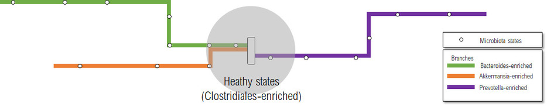

::: {.hero-grid}
::: {.hero-copy}

Microbial ecology · Metagenomics · Ecosystem design

# From microbiome states to designed ecosystems.

I study how microbial communities organize, persist and exchange members — then turn that ecological knowledge into ways of steering food and gut ecosystems.

Observe<i>→</i>Understand<i>→</i>Design<i>→</i>Control

:::

::: {.atlas aria-label="Abstract microbial ecosystem map"}

:::
:::

::: {.section}
::: {.section-head}
## A research atlas

The work moves across scales: from population-level microbiome stratification to interaction mechanisms, community coalescence and engineered microbial fluxes.
:::

::: {.bento}
::: {.tile .wide .dark .reveal}
01 · States & trajectories

### Mapping global branches

Moving beyond static signatures to identify reproducible ecosystem states and the trajectories that connect them.

{alt="Microbiome branches represented as train stations"}
:::

::: {.tile .coral .reveal}
02 · Mechanisms

### What makes a community stable?

Ecological interactions, environmental constraints and the rules governing food–gut ecosystem coalescence.
:::

::: {.tile .acid .reveal}
03 · Design

### Ecological chassis

From designed consortia to digital twins: building microbial systems whose behavior can be anticipated and steered.
:::

::: {.tile .wide .reveal}
Thesis

### From signatures to states, from states to trajectories, and from trajectories to engineered microbial fluxes.

[Explore the research →](research.qmd){.cta}
:::
:::
:::

::: {.section}
::: {.section-head}
## The research programme

A connected programme rather than a collection of isolated projects.
:::

::: {.story}
::: {.story-row .reveal}
<strong>01</strong>

### Observe

Stratify microbiomes across populations and environments; describe states without reducing ecosystems to lists of taxa.
:::
::: {.story-row .reveal}
<strong>02</strong>

### Understand

Resolve the ecological mechanisms behind stability, transitions and microbial exchanges between fermented foods and the gut.
:::
::: {.story-row .reveal}
<strong>03</strong>

### Design

Combine ecological chassis, synthetic communities and digital twins to make microbial fluxes experimentally tractable.
:::
:::
:::

