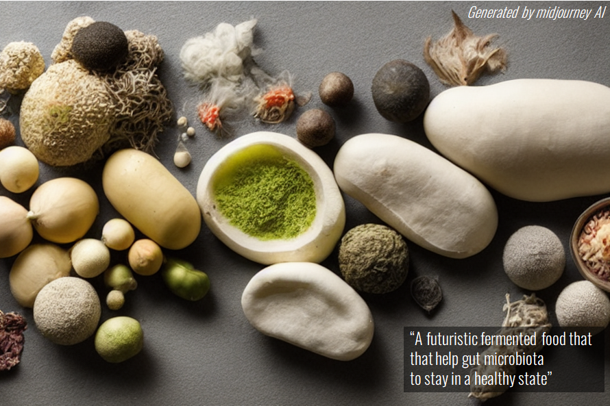

::: {.page-intro}

Current portfolio

# Experiments for living systems.

Each project addresses a different layer of the same question: how can we observe, model and ultimately design microbial ecosystem trajectories?
:::

::: {.bento}
::: {.tile .wide .dark}
### SynthPlex

Synthetic microbial communities as controllable experimental systems for testing ecological assembly and function.

Synthetic ecology Community design
:::
::: {.tile .coral}
### MicroEngine

Engineering principles for microbial ecosystems: from interaction maps to robust functional consortia.
:::
::: {.tile}
### FermenTwin

Digital twins of fermented ecosystems linking measurements, models and intervention scenarios.
:::
::: {.tile .wide}
### DOMINO

Understanding microbial and molecular interactions across diet, fermented foods and the intestinal ecosystem.

{alt="Artificial intelligence interpretation of fermented microbial ecosystems"}
:::
::: {.tile .acid}
### Le French Gut

Population-scale mapping of the French gut microbiome and its diversity.
:::
::: {.tile}
### LivinGut

Living models for studying microbial dynamics and their response to controlled perturbations.
:::
:::

