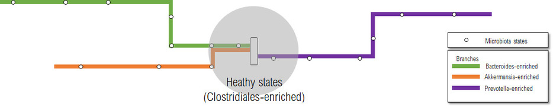
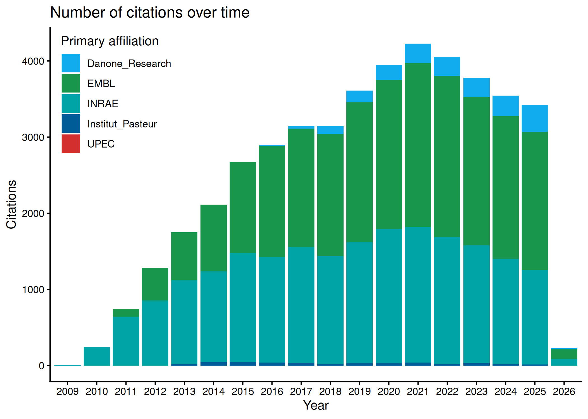

::: {.page-intro}

Selected evidence

# Publications as landmarks.

Selected outputs are organized around the questions they helped open: stratification, stability, community coalescence and ecosystem design.
:::

::: {.bento}
::: {.tile .wide}
### Global microbiome branches

Population-scale analyses that reframed variation as recurrent ecological configurations rather than isolated taxonomic signatures.

{alt="Conceptual representation of global microbiome branches"}
:::
::: {.tile .dark}
### Ecological chassis

Mechanistic work using *Bifidobacterium adolescentis* to connect community context, growth conditions and functional outcomes.
:::
::: {.tile}
### Food–gut coalescence

Experimental and computational studies of microbial transfer, persistence and functional exchange.
:::
::: {.tile .acid}
### Research profile

For the complete and current list, consult [Google Scholar](https://scholar.google.com/citations?user=HKmBcCkAAAAJ) and [ORCID](https://orcid.org/0000-0002-3398-7531).
:::
:::

::: {.section}
::: {.figure}
{alt="Publication and citation overview"}
<figcaption>Bibliometric overview exported from the previous portfolio.</figcaption>
:::
:::

